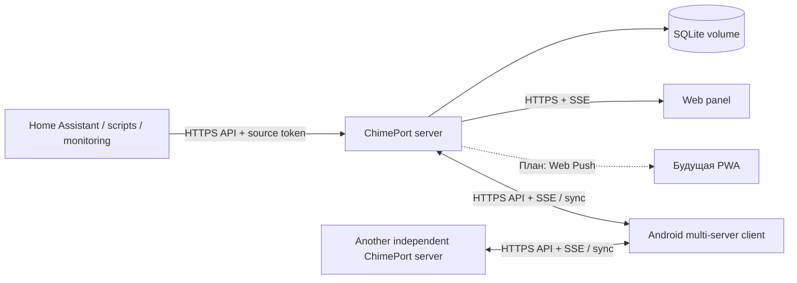

# 02. Архитектура

**Статус:** описание текущей архитектуры сервера v0.1.2 и проектных расширений (обновлено 2026-11-05). Текущие API перечислены в [API v1](03-API.md), отличайте их от планов PWA/Web Push, `/devices` и дополнительных серверных модулей.

## 1. Общая схема

Нет центрального облака, глобальных аккаунтов и зависимости серверов друг от друга. Web Push сам по себе использует инфраструктуру push-сервисов браузеров, поэтому «нет обязательного центра проекта» не означает «нет третьих сторон при использовании Web Push».

## 2. Реализованный стек

- **Сервер:** Go, стандартный HTTP-сервер, REST API v1 и SSE; статика (`index.html`, JavaScript и CSS) встроена в Go-бинарник через `embed`.
- **Данные:** SQLite с WAL и миграциями (schema 3 в v0.1.2), постоянный том `/data`.
- **Веб-панель:** обычные HTML/CSS/JavaScript без TypeScript SPA и отдельной Node-службы; три темы Ocean/Paper/Control.
- **Android:** Kotlin, Jetpack Compose, Material 3, локальный кэш, синхронизация с несколькими независимыми серверами и фоновая доставка best effort.
- **Развёртывание:** один контейнер ChimePort, внешний HTTPS reverse proxy; нет Redis, брокера и обязательного центрального сервиса.

**Планы, не текущая реализация:** PWA/Service Worker, Web Push, серверные устройства и receipts, расширенные ACL и масштабирование. PostgreSQL и другие брокеры не требуются для текущей модели.

## 3. Логические модули сервера

- `auth`: парольные аккаунты, сессии, выдача и отзыв клиентских сессий.
- `admin`: пользователи, роли, bootstrap, аудит административных событий.
- `sources`: логические источники сообщений и ограниченные API-токены.
- `channels`: личные каналы, подписки, будущие ACL.
- `messages`: валидация, идемпотентность, транзакционная запись, получение истории.
- `delivery`: события для активных соединений, Web Push, диагностика доставки.
- `devices`: регистрация устройств, адресов подписки Web Push, курсоров и подтверждений.
- `settings`: правила уведомлений и настройки пользователя (в части, применимой к нескольким клиентам).

## 4. Данные: фактическая схема и проектные расширения

Фактически в SQLite v3 есть таблицы `instance`, `users`, `sessions`, `channels`, `sources`, `source_tokens`, `token_channels`, `messages`, `idempotency`, `read_states`, `publication_windows`, `retention_watermarks`. Названия и столбцы следует сверять с `server/internal/app/store.go` при миграциях.

Таблица ниже сохраняется как **первоначальный проект модели**, а не описание существующей схемы: например, отдельные `subscriptions`, `devices`, `device_delivery`, `web_push_subscriptions` сейчас не созданы.

| Сущность | Основные поля |
| --- | --- |
| `users` | `id`, `username`, `password_hash`, `role`, `disabled`, `created_at` |
| `sources` | `id`, `owner_user_id`, `name`, `description`, `created_at` |
| `source_tokens` | `id`, `source_id`, `prefix`, `secret_hash`, `allowed_channel_ids`, `expires_at`, `revoked_at`, `last_used_at` |
| `channels` | `id`, `owner_user_id`, `slug`, `name`, `description`, `created_at` |
| `subscriptions` | `id`, `user_id`, `channel_id`, `enabled` |
| `messages` | `id`, `channel_id`, `source_id`, `title`, `body`, `priority`, `created_at`, `expires_at`, `metadata_json` |
| `idempotency` | `source_id`, `key_hash`, `request_hash`, `message_id`, `expires_at` |
| `read_states` | `user_id`, `message_id`, `read_at` (или сжатая эквивалентная структура) |
| `devices` | `id`, `user_id`, `type`, `label`, `last_seen_at`, `revoked_at` |
| `device_delivery` | `device_id`, `message_id`, `received_at` / агрегированный watermark для диагностики |
| `web_push_subscriptions` | `device_id`, `endpoint`, `keys`, `updated_at` (секретные данные защищены) |

ID серверных сообщений: UUIDv7/ULID либо числовая монотонная последовательность **в пределах сервера**, с надёжной пагинацией. Для мультисерверного Android глобальный ключ записи — `(server_identity, message_id)`. Курсор нельзя выводить из пользовательского времени.

**Важно:** сервер должен хранить долговременный `instance_id`, не меняющийся при обновлении/рестарте и включённый в backup. Если URL стал указывать на другую инсталляцию, Android обязан предупредить перед повторным использованием сохранённых данных.

## 5. Приём сообщения

1. Клиент-источник отправляет `POST /api/v1/messages` через HTTPS.
2. Сервер проверяет токен, канал и квоты, валидирует поля, проверяет `Idempotency-Key`.
3. В одной транзакции записывает сообщение и ключ идемпотентности.
4. **Только после успешного commit** отвечает `201 Created` с ID; повтор с тем же ключом и телом возвращает существующий результат.
5. После commit сервер сигнализирует активным SSE-клиентам; Web Push — будущая функция.
6. Клиент получает полные данные или запрашивает их через sync API.

Если доставка wake-up не удалась, хранилище сохраняет сообщение. Если сервер упал после commit, но до ответа, повтор по идемпотентному ключу не создаёт дубль.

## 6. Поток синхронизации

- При подключении Android/Web клиент предъявляет пользовательскую сессию (не source token).
- Клиент запрашивает `GET /api/v1/messages?after=<cursor>&limit=N` и применяет результаты идемпотентно.
- После завершения начальной синхронизации открывает поток событий, который является лишь сигналом о новых данных.
- При reconnect, истечении сессии или обнаруженном пропуске запускает досинхронизацию.
- Пагинация использует серверный стабильный курсор. После истечения retention сервер явно возвращает границу доступной истории, а не притворяется, что пропусков не было.
- Локальный кэш Android всегда отделён по паре `(server_instance_id, user_id)`.

Для устранения гонки между начальной sync и подпиской клиент после установления потока выполняет контрольную sync или использует согласованный серверный watermark.

## 7. Авторизационные границы

- `source token` публикует только в разрешённые каналы, не может читать историю или управлять пользователями.
- Пользовательская сессия читает собственные/разрешённые сообщения и управляет только своими ресурсами.
- Админ не получает автоматически доступ к личному содержимому без отдельной явно задокументированной политики; админские полномочия ограничены необходимым.
- Все запросы проверяют владение сущностями **на сервере**, независимо от кнопок в интерфейсе.

## 8. Масштабирование и обновления

Первый релиз — одна инсталляция, один процесс записи, SQLite volume. Не заявлять «горизонтальное масштабирование» без распределённого хранения и брокера. Миграции версионируются, перед потенциально разрушительными обновлениями требуется backup. Встроенная диагностика должна показывать версию схемы, размер базы, задержки синхронизации и время последней успешной доставки (без обещаний состояния ОС).
